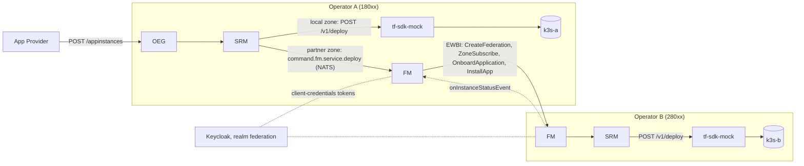

# oop-local-docker

Two [Open Operator Platform](https://labs.etsi.org/rep/oop) operators on one machine with Docker
Compose, federated with each other over the GSMA OPG.04 East/Westbound interface (EWBI). Each
operator runs its own OEG, SRM, FM, Postgres, NATS and k3s cluster; one Keycloak issues the
partner tokens.

> **Status: work in progress, SRM does not build out of the box yet.** The harness needs two SRM
> branches that are not in `develop`: the federated deploy (`fix/fm-wait-for-partner`, stacked on
> SRM !28 and !29) and the HTTP seam `tf-sdk-mock` answers (`test/mock-tfsdk`). They no longer
> merge cleanly, so `./prepare.sh` stops at that step. FM and OEG build from `develop`.



## Run it

Needs Docker with Compose v2, git, curl and python3.

```bash
./prepare.sh                # clone FM, OEG, SRM into ./src and write ./secrets
docker compose up -d --build
./seed.sh                   # a zone per operator, register each FM at the other, federate both ways
./e2e.sh                    # deploy an nginx from operator A onto operator B's k3s
```

`e2e.sh` checks the federated deploy twice: from operator A's FM, and from an App Provider's
`POST /appinstances` at OEG-A, which must turn `ready` only once the app runs in operator B's k3s.
It ends with `PASS` or `FAIL: <reason>`.

`docker compose down -v` removes everything, including both clusters.

## Ports

| | Operator A | Operator B |
|---|---|---|
| OEG | 18081 | 28081 |
| SRM | 18082 | 28082 |
| FM | 18083 | 28083 |
| Keycloak (shared) | 18080 | |

Operator A is MCC-MNC `001-01`, operator B `001-02` (ITU test-network codes).

## Choosing what to build

`prepare.sh` reads:

| Variable | Default | |
|---|---|---|
| `FM_REF` | `develop` | branch of `federation-manager` |
| `OEG_REF` | `develop` | branch of `open-exposure-gateway` |
| `SRM_REF` | `fix/fm-wait-for-partner` | branch of `service-resource-manager` |
| `SRM_MERGE` | `test/mock-tfsdk` | merged on top of `SRM_REF`; empty to skip |

To build from your own checkouts instead, skip `prepare.sh` and set `FM_ROOT`, `OEG_ROOT` and
`SRM_ROOT` in `.env` (FM's `keycloak/realm-import.json` still has to be readable at `FM_ROOT`, and
`./secrets` must hold the `originating-op-1` and `originating-op-2` client secrets).

## What the harness fills in by hand

- **SRM topology.** SRM has no topology bootstrap yet, so `seed-srm-topology.sh` writes one
  deployable zone (zone, compute domain, `deploy_workload` capability, control-path binding)
  into each SRM database. The zone UUIDs are fixed so agreements and `e2e.sh` can refer to them.
- **Federation agreements.** FM has no API for them yet; `seed.sh` inserts one per partner.
- **Partner registration and federation** go straight to FM's `/internal/*` API, which has no
  authentication today. In a real deployment those calls come through OEG.
- **tf-sdk.** `tf-sdk-mock` stands in for tf-sdk: it applies a Namespace, Deployment and Service
  with `kubectl` and waits for the rollout.
- **OEG image.** The compose file builds OEG with an inline Dockerfile that pins SQLAlchemy below
  2.1, because OEG's own Dockerfile installs without its lock file.

## Behind a TLS-inspecting proxy (e.g. Cloudflare WARP)

The host's Docker may trust the proxy's root CA, but containerd inside the k3s containers does
not, so k3s can't pull any image (`x509: certificate signed by unknown authority`), not even its
own `pause` image.

- Pull images on the host and import them into each k3s:
  `docker save IMAGE | docker exec -i oop-r2-k3s-b-1 ctr -n k8s.io images import -`.
  At least `rancher/mirrored-pause:3.6`, `rancher/mirrored-coredns-coredns:1.10.1` and every
  app image the test deploys (`nginx:1.27-alpine`, `curlimages/curl:8.10.1`). Use tagged images:
  a tagged image defaults to `imagePullPolicy: IfNotPresent` and runs from the imported copy,
  `:latest` always pulls.
- k3s already starts with `--disable=traefik,metrics-server,local-storage`. A metrics-server that
  can't pull its image leaves a broken API group, and Kubernetes then never finishes deleting a
  namespace, so every terminate hangs.

## License

Apache-2.0, see [LICENSE](LICENSE).
